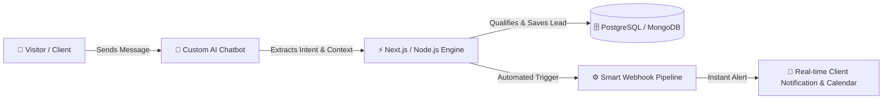

<div align="center">

<h3>
  
  Hey there! I'm Mehmood Hassan
</h3>

<a href="https://git.io/typing-svg"></a>

<br/><br/>

<a href="https://github.com/mehmoodkhan07"></a>
<a href="https://github.com/mehmoodkhan07"></a>


</div>


## 💻 Terminal Overview

```bash
╔══════════════════════════════════════════════════════════════════════════════════╗
║  mehmood@workstation:~$ whoami                                                   ║
║  > Mehmood Hassan — Software Engineer & Full Stack Web Architect                 ║
║                                                                                  ║
║  mehmood@workstation:~$ cat tech-dna.json                                        ║
║  > {                                                                             ║
║      "primary_role": "Software Engineer",                                        ║
║      "core_ecosystem": "JavaScript / TypeScript (Next.js · React · Node.js)",    ║
║      "backend_runtime": "Node.js · Express.js · RESTful APIs",                   ║
║      "chatbot_mastery": "Custom Tight AI Chatbots (24/7 Lead-Gen & Support)",    ║
║      "automation": "Webhooks · Event Pipelines · API Orchestration",             ║
║      "co_founder": "Olive Growth Agency 🌿",                                     ║
║      "ship_speed": "7–14 Day Turnaround · Zero Bloat · Production Ready"         ║
║    }                                                                             ║
║                                                                                  ║
║  mehmood@workstation:~$ npm run deploy:chatbot --tight                           ║
║  > [ACTIVE] Intelligent Conversational Chatbot & Automation Running! 🤖⚡        ║
╚══════════════════════════════════════════════════════════════════════════════════╝
```


## 👨‍💻 About Me


Software Engineer and Full-Stack JavaScript/TypeScript Specialist. My primary stack is **Next.js, React, Node.js, and TypeScript**. I engineer high-performance web applications with modular architecture, resilient backend APIs, and **custom, tight AI Chatbots** that automate lead intake and customer communication 24/7.

- 💻 **Software Engineering**: Building clean, scalable web applications with Next.js App Router, React Server Components, and Node.js.
- 🤖 **Custom AI Chatbots**: Building full tight, context-aware chatbots that autonomously qualify leads, book appointments, and answer questions.
- ⚙️ **Smart Automations**: Connecting APIs, webhooks, and backend events to eliminate repetitive human friction and save hours weekly.
- 🌐 **Modern Frontend & UI**: Pixel-perfect, high-converting interfaces using TailwindCSS, Framer Motion, and mobile-first principles.
- 🌿 **Co-founder @ Olive Growth Agency**: Leading technical engineering and building digital growth infrastructure for global clients.
- 📧 **Direct Reach**: [mehmood9395@gmail.com](mailto:mehmood9395@gmail.com)

<br clear="right"/>

---

## ⚡ What I Engineer & Deliver

<div align="center">

<table>
<tr>
<td width="50%" valign="top">
<h3>💻 Software Engineering & Full-Stack Apps</h3>
<ul>
  <li><b>Core Stack:</b> Next.js 14, React, Node.js, Express, TypeScript</li>
  <li><b>High Performance:</b> Sub-second load times, optimal Core Web Vitals, SEO architecture</li>
  <li><b>Clean Architecture:</b> Type-safe APIs, modular folder structure, zero spaghetti code</li>
  <li><b>Data Engineering:</b> PostgreSQL, MongoDB, Supabase, indexing & optimized queries</li>
</ul>
</td>
<td width="50%" valign="top">
<h3>🤖 Custom AI Chatbots & Smart Automations</h3>
<ul>
  <li><b>Tight Conversational AI:</b> 24/7 intelligent bots trained on business knowledge</li>
  <li><b>Automated Lead-Gen:</b> Interactive visitor qualification and instant appointment booking</li>
  <li><b>Workflow Pipelines:</b> Instant webhook triggers, CRM sync, alert routing</li>
  <li><b>Omnichannel:</b> Website chat widgets, WhatsApp, Messenger, and custom portals</li>
</ul>
</td>
</tr>
</table>

</div>

---

## 🔄 AI Chatbot & Automation Architecture




## 🛠️ Tech Stack & Tools

<table>
<tr>
  <td width="22%"><b>🗣️ Core Languages</b></td>
  <td>
    
    
    
    
    
    
  </td>
</tr>
<tr>
  <td><b>🎨 Frontend Ecosystem</b></td>
  <td>
    
    
    
    
    
    
    
    
  </td>
</tr>
<tr>
  <td><b>⚙️ Backend & APIs</b></td>
  <td>
    
    
    
    
    
  </td>
</tr>
<tr>
  <td><b>🤖 Chatbots & Automations</b></td>
  <td>
    
    
    
    
    
  </td>
</tr>
<tr>
  <td><b>🗄️ Databases & ORM</b></td>
  <td>
    
    
    
    
    
  </td>
</tr>
<tr>
  <td><b>☁️ Cloud & DevOps</b></td>
  <td>
    
    
    
    
    
    
  </td>
</tr>
<tr>
  <td><b>🛠️ Tools & Productivity</b></td>
  <td>
    
    
    
    
    
    
  </td>
</tr>
</table>

---

## 🚀 Projects & System Builds

<div align="center">

| 🔨 Project | 🛠️ Tech Stack | 💡 Focus / Role | 📌 Status |
|:---|:---|:---|:---:|
| **Intelligent AI Lead-Gen Bot** | Next.js · OpenAI · Node.js · MongoDB | 24/7 Automated Intake & Lead Qualification | 🟢 Production |
| **Olive Growth Agency Platform** | Next.js · TailwindCSS · Framer Motion | High-Converting Agency Portal & Core Systems | 🟢 Live |
| **Smart Business Automation Suite** | Node.js · Webhooks · Supabase · APIs | Automated Workflows & Data Pipeline Sync | 🟡 Active Dev |
| **E-Commerce & Custom Portal Engine** | Next.js · Stripe · PostgreSQL · Tailwind | Scalable Storefront & Checkout Architecture | 🔵 In Progress |

</div>

---

## 🧠 Skill Proficiency

<div align="center">

| Competency | Level | Proficiency Bar | Focus Area |
|:---|:---:|:---|:---|
| **Software Engineering** | 90% | `▓▓▓▓▓▓▓▓▓░` Advanced | System Architecture, Clean Code & API Design |
| **JavaScript & TypeScript** | 94% | `▓▓▓▓▓▓▓▓▓▓` Master | Modern ES6+, Async Programming & Type Safety |
| **React / Next.js** | 92% | `▓▓▓▓▓▓▓▓▓░` Expert | Next.js App Router, SSR/SSG, Responsive UI |
| **Node.js & Express Backend** | 88% | `▓▓▓▓▓▓▓▓░░` Advanced | REST APIs, Middlewares, Auth & Data Streams |
| **Custom AI Chatbots** | 90% | `▓▓▓▓▓▓▓▓▓░` Expert | Conversational Flow, OpenAI Integration, Lead-Gen |
| **Databases (SQL & NoSQL)** | 84% | `▓▓▓▓▓▓▓▓░░` Advanced | PostgreSQL, MongoDB, Schema Design & Indexing |
| **TailwindCSS & UI Design** | 95% | `▓▓▓▓▓▓▓▓▓▓` Master | Micro-interactions, Glassmorphism & Mobile-First |
| **Smart Automations** | 86% | `▓▓▓▓▓▓▓▓░░` Advanced | Webhooks, Event Triggers & Business Workflows |

</div>

---

## 🏅 Why Work With Me?

<div align="center">

<table>
<tr>
<td align="center" width="25%">
<br/>
Next.js & Node.js architecture<br/>with zero technical debt.
</td>
<td align="center" width="25%">
<br/>
Intelligent bots that capture<br/>leads while you sleep.
</td>
<td align="center" width="25%">
<br/>
Rapid, disciplined delivery<br/>without cutting corners.
</td>
<td align="center" width="25%">
<br/>
Co-founder @ Olive Growth,<br/>serving clients worldwide.
</td>
</tr>
</table>

</div>

---

## 💼 Solutions & Services

<div align="center">

|  | 🛎️ Solution | 📦 Engineering Deliverable | ⏱️ Turnaround |
|:---:|:---|:---|:---:|
| 💻 | DM **"ENGINEER"** | Custom Web Application · Full-Stack Next.js / Node.js · Scalable Backend | 7–14 days |
| 🤖 | DM **"CHATBOT"** | Full Tight AI Chatbot · 24/7 Lead Capture, Onboarding & Support Bot | 3–7 days |
| 🌐 | DM **"WEBSITE"** | Premium Business Website · SEO-optimized · 100% Mobile Responsive | 5–10 days |
| ⚙️ | DM **"AUTOMATE"** | Smart Business Automation · API & Webhook Workflows (Save 10+ hrs/wk) | 3–7 days |
| 🔍 | DM **"AUDIT"** | Free Code, Architecture, Performance & SEO Review · Actionable Plan | 24 hours |

</div>


## 📊 GitHub Analytics

<div align="center">


</div>

<div align="center">


</div>

<div align="center">


</div>

<div align="center">


</div>

---

## 📈 Activity & Contributions

<div align="center">


</div>

---

## 🐍 Contribution Snake

<div align="center">

<picture>
  <source media="(prefers-color-scheme: dark)" srcset="https://raw.githubusercontent.com/mehmoodkhan07/mehmoodkhan07/output/github-contribution-grid-snake-dark.svg" />
  <source media="(prefers-color-scheme: light)" srcset="https://raw.githubusercontent.com/mehmoodkhan07/mehmoodkhan07/output/github-contribution-grid-snake.svg" />
  
</picture>

</div>


## 🎯 Engineering Principles

<div align="center">

```
 ╔════════════════════════════════════════════════════════════════╗
 ║  🚀  Ship clean software fast — iterate with real users        ║
 ║  🧹  Write readable, maintainable code you'd trust at 3 AM     ║
 ║  🤖  Automate repetitive friction, build intelligent chatbots ║
 ║  📱  Mobile-First is not optional — it's the standard         ║
 ║  ⚡  Optimize performance: every 100ms lag loses users        ║
 ║  💬  Clear communication & transparent delivery, always        ║
 ╚════════════════════════════════════════════════════════════════╝
```

</div>

---

## ⚡ Quick Highlights

<div align="center">

| 💡 | Engineering Highlight |
|:---:|:---|
| 💻 | **Software Engineer** dedicated to building resilient, clean, and scalable web platforms |
| 🤖 | **Custom AI Chatbots** that qualify leads, answer FAQs, and book clients 24/7 on autopilot |
| ⚡ | **7–14 Day Delivery** — No clunky page builders, no code bloat, just pure engineered solutions |
| 🌿 | **Co-founder @ Olive Growth Agency** — Leading technical delivery for international businesses |
| 🎯 | **Mobile-First Standard** — Tested rigorously across devices for flawless responsiveness |
| ☕ | Powered by modern JavaScript / TypeScript, coffee, and shipping impactful software 🚀 |

</div>

---

## 😂 Dev Joke of the Day

<div align="center">


</div>

---

## 💡 Engineering Quote

<div align="center">


</div>


## 📫 Let's Connect & Build Together

<div align="center">

<a href="https://www.linkedin.com/in/mehmoodkhann/">
  
</a>
<a href="https://github.com/mehmoodkhan07">
  
</a>
<a href="mailto:mehmood9395@gmail.com">
  
</a>
<a href="https://instagram.com/mehmood_khan__007">
  
</a>
<a href="https://www.facebook.com/profile.php?id=100053284860369">
  
</a>

<br/><br/>


</div>

---

<div align="center">


<br/>

⭐ **Engineered with precision by [Mehmood Hassan](https://github.com/mehmoodkhan07)** — *Drop a ⭐ if you like the profile!*

</div>
